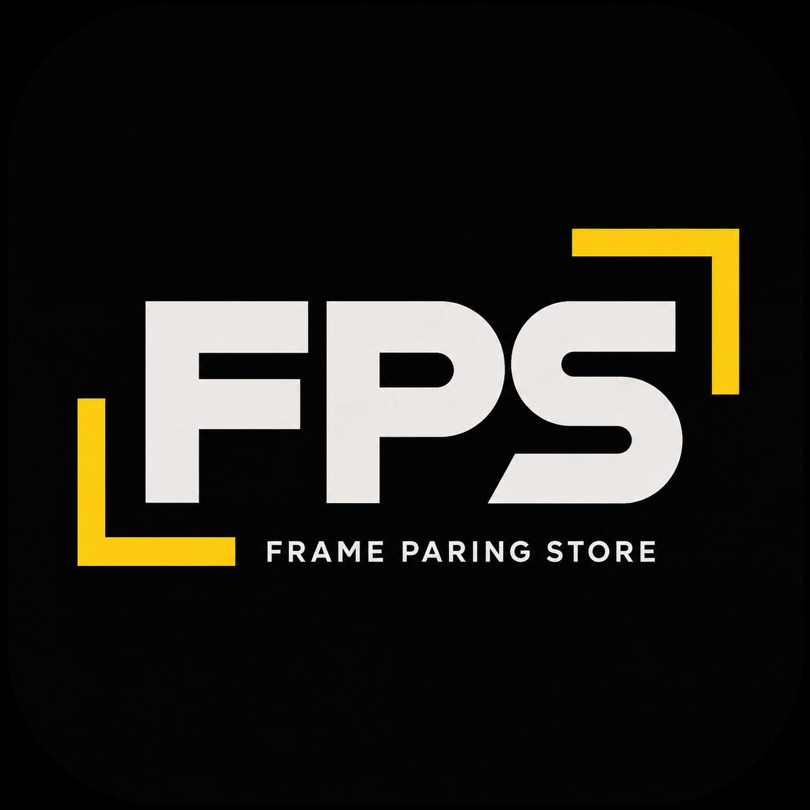
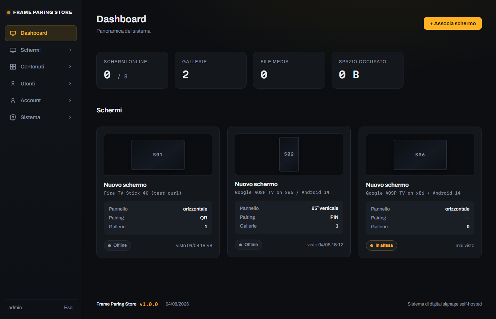

<p align="center">
  
</p>

<h1 align="center">Frame Paring Store</h1>

Sistema di **digital signage self-hosted**: un CMS in PHP che gira su un normale
hosting condiviso e un'app per Android TV / Fire Stick che riproduce in loop
immagini e video, anche senza connessione.

Nato per vetrine e punti vendita: si carica via FTP, non richiede accesso SSH,
non dipende da servizi esterni e non ha canoni.



## Caratteristiche

**Gestione contenuti**
- Gallerie di immagini e video con ordinamento drag & drop
- Per ogni file: rotazione (0/90/180/270), adattamento *contain* o *crop*,
  durata a schermo, audio on/off per i video
- 11 transizioni (dissolvenze, scorrimenti, zoom, Ken Burns, casuale) con
  durata configurabile: impostazione predefinita per galleria e override di
  entrata/uscita sul singolo file
- Anteprima nel browser che riproduce i media reali con le transizioni vere,
  con scorrimento manuale avanti/indietro
- Cestino con ripristino ed eliminazione automatica dopo N giorni

**Schermi**
- Tre metodi di associazione: PIN a 6 cifre, QR code, URL di configurazione
- Metadati del pannello fisico (pollici, orientamento verticale/orizzontale)
- Assegnazione di più gallerie per schermo, con ordine di riproduzione
- Accensione programmata a fasce orarie: fuori orario schermo nero o immagine
  di cortesia
- Stato online/offline in tempo reale, revoca dell'accesso

**Utenti**
- Ruoli predefiniti (Amministratore, Editor, Operatore) e permessi granulari
  personalizzabili per singolo utente
- Anagrafica, profilo personale, attivazione/disattivazione

**Personalizzazione**
- Nome, logo, colore e testi del CMS e della schermata TV modificabili
  dall'amministratore, senza ricompilare l'app
- Banner in sovraimpressione con logo e data/ora in nove posizioni,
  configurabile per tutti gli schermi o per il singolo

**Multilingua**
- Interfaccia in italiano e inglese, pannello e televisori
- Ogni utente sceglie la propria lingua; una predefinita di sistema vale per
  chi non l'ha scelta e per gli schermi
- Aggiungerne una richiede un file di traduzione e una riga di elenco

**App TV**
- Cache locale dei media: riproduce anche senza rete, scarica solo ciò che cambia
- Avvio automatico all'accensione del dispositivo
- Impostazioni richiamabili dal telecomando per cambiare server o disassociare

## Come funziona

```
   TV (rete del negozio)              Server (hosting condiviso)         Amministratore
            │                                    │                             │
            ├── chiede un codice ───────────────►│                             │
            │◄─ PIN + credenziale temporanea ────│                             │
   mostra PIN e QR a schermo                     │◄── inserisce il PIN nel CMS ┤
            │                          associa e rilascia il token             │
            ├── ritira il token ────────────────►│                             │
            │                                    │                             │
            └── scarica playlist e media, poi riproduce dalla cache locale
```

Nessuna configurazione di rete: la TV apre la connessione verso l'esterno,
quindi funziona dietro qualsiasi router senza aprire porte. Amministratore e
televisore non devono trovarsi sulla stessa rete.

## Requisiti

| Componente | Requisito |
|---|---|
| Hosting | PHP 8.0+ con PDO MySQL, `finfo`, cartella scrivibile |
| Database | MySQL 5.7+ o MariaDB 10.3+ |
| Dispositivi | Android 5.1+ / Fire OS 5+ (qualsiasi Fire TV Stick, Android TV, box Android) |
| Sviluppo app | Android Studio (solo per compilare l'APK) |

Nessuna dipendenza da Composer, npm o servizi cloud.

## Installazione rapida

1. Crea un database MySQL vuoto dal pannello dell'hosting e annota le credenziali.
2. Carica il contenuto di `server/` nella cartella pubblica dell'hosting.
3. Apri `install.php` nel browser: l'installazione guidata controlla i requisiti,
   crea le tabelle, scrive la configurazione e ti fa creare l'amministratore.
4. Elimina `install.php` dal server.

Guida completa: [docs/installazione.md](docs/installazione.md).

## Documentazione

| Guida | Contenuto |
|---|---|
| [Installazione](docs/installazione.md) | Requisiti, caricamento su hosting, configurazione, HTTPS |
| [App per TV](docs/app-tv.md) | Compilazione APK, sideload su Fire Stick e Android TV, avvio automatico |
| [Utilizzo del CMS](docs/utilizzo.md) | Schermi, gallerie, transizioni, fasce orarie, utenti, cestino |
| [API](docs/api.md) | Riferimento degli endpoint usati dai dispositivi |
| [Sicurezza](docs/sicurezza.md) | Modello di autorizzazione e scelte di protezione |
| [Aggiornamento](docs/aggiornamento.md) | Come aggiornare server e app senza perdere dati |

## Struttura del repository

```
frame-paring-store/
├── database/schema.sql      Schema completo del database
├── server/                  Da caricare sull'hosting
│   ├── api/v1/              API REST per i dispositivi
│   ├── cms/                 Pannello di amministrazione
│   ├── core/                Configurazione, database, logica condivisa
│   └── uploads/             File caricati (chiusa al web)
├── app-androidtv/           Progetto Android (Kotlin)
└── docs/                    Documentazione
```

## Tecnologie

**Server** — PHP 8 senza framework né librerie esterne, MySQL via PDO con
prepared statement, front-end in HTML/CSS/JavaScript vanilla. L'unica libreria
di terze parti è [Sortable.js](https://github.com/SortableJS/Sortable) per il
drag & drop, inclusa nel repository.

**App** — Kotlin nativo per Android TV, tre sole dipendenze:
[Media3/ExoPlayer](https://github.com/androidx/media) per i video,
[ZXing](https://github.com/zxing/zxing) per generare il QR sul dispositivo,
coroutines per la rete. Nessuna libreria nativa: la stessa APK funziona su
ARM, ARM64 e x86.

## Licenza

Distribuito con licenza **GNU Affero General Public License v3.0** — vedi
[LICENSE](LICENSE).

In breve: puoi usare, studiare, modificare e ridistribuire il progetto
liberamente. Se lo modifichi e lo offri come servizio accessibile in rete, devi
rendere disponibile il codice modificato con la stessa licenza.

Copyright © 2026 Davide Pica
