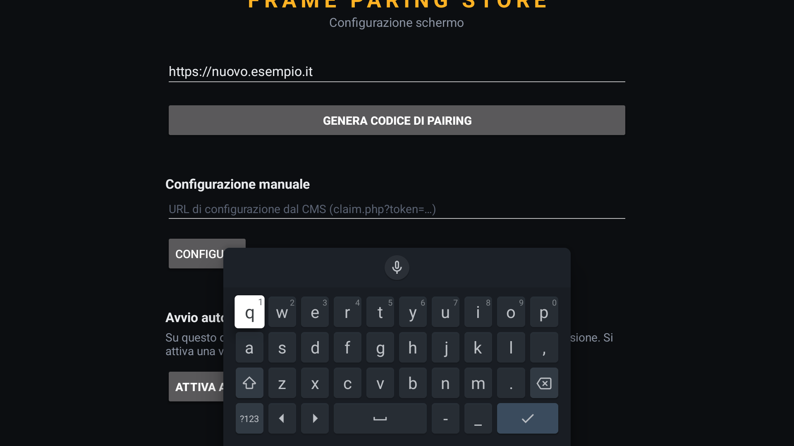

# App per Android TV e Fire Stick

L'app è scritta in Kotlin nativo e funziona su qualsiasi dispositivo Android
dalla versione 5.1 in poi: **una sola APK** copre Fire TV Stick (ogni
generazione), Android TV, Google TV e box Android generici.



## Perché una sola versione

Fire OS è Android con un launcher diverso: l'app dichiara entrambe le categorie
di avvio (`LEANBACK_LAUNCHER` e `LAUNCHER`), quindi compare nel menu di tutti e
due i sistemi.

Non contiene librerie native — la riproduzione usa i decoder hardware del
dispositivo — quindi lo stesso file funziona su ARM 32 bit, ARM64 e x86 senza
varianti. Le differenze fra versioni di Android sono gestite a runtime.

## Compilazione

### Con Android Studio (consigliato)

1. Installa [Android Studio](https://developer.android.com/studio): include già
   JDK e Android SDK.
2. `File → Open` e seleziona la cartella `app-androidtv`.
3. Attendi la sincronizzazione di Gradle (la prima volta scarica le dipendenze).
4. **Prima di compilare**, imposta l'indirizzo del tuo server in
   `app/build.gradle.kts`:

   ```kotlin
   buildConfigField("String", "DEFAULT_BASE_URL", "\"https://tuodominio.it/signage\"")
   ```

   Così le TV partiranno già puntate al server giusto e non dovrai digitare
   l'indirizzo col telecomando.
5. `Build → Build App Bundle(s) / APK(s) → Build APK(s)`.
6. L'APK si trova in `app/build/outputs/apk/debug/app-debug.apk` (circa 4,5 MB).

### Da riga di comando

Serve JDK 17 e la variabile `ANDROID_HOME` configurata:

```
gradlew assembleDebug
```

### Versione di distribuzione

L'APK *debug* è firmata con una chiave temporanea generata da Android Studio:
va benissimo per provare, ma per un'installazione stabile conviene generare una
release con una chiave tua (`Build → Generate Signed App Bundle / APK`), che
attiva anche la minificazione e riduce le dimensioni.

> ⚠️ **Tieni attiva la firma V1 (Jar Signature).** Android sotto la 7.0 —
> quindi Fire OS 5, cioè i Fire TV Stick di prima e seconda generazione — sa
> verificare **solo** lo schema V1. Un'APK firmata unicamente V2/V3 su quei
> dispositivi non si installa e restituisce *«Errore di analisi del
> pacchetto»*, che sembra un'APK corrotta ma è solo una firma che il sistema
> non sa leggere. Nella finestra di firma di Android Studio spunta sia **V1**
> sia **V2**; da riga di comando usa
> `apksigner sign --v1-signing-enabled true --v2-signing-enabled true`.
>
> Per controllare un'APK già firmata:
> ```
> apksigner verify --verbose --min-sdk-version 22 app-release.apk
> ```
> Deve rispondere `Verified using v1 scheme (JAR signing): true`.

> Le APK firmate con chiavi diverse non si aggiornano a vicenda: se passi da
> debug a release devi disinstallare prima la versione precedente.

## Installazione sui dispositivi

### Fire TV Stick

1. *Impostazioni → La mia Fire TV → Opzioni sviluppatore*: attiva **Debug ADB**
   e **App da origini sconosciute**.
2. Annota l'indirizzo IP della TV (*Impostazioni → La mia Fire TV → Info → Rete*).
3. Dal PC, sulla stessa rete:

   ```
   adb connect INDIRIZZO_IP
   adb install app-debug.apk
   ```

In alternativa, senza PC: installa l'app **Downloader** dallo store Amazon e
apri l'indirizzo diretto dell'APK (se l'hai messa su un tuo spazio web).

### Android TV / Google TV

1. *Impostazioni → Info*: premi sette volte su **Build** per sbloccare le
   opzioni sviluppatore.
2. *Impostazioni → Sistema → Opzioni sviluppatore*: attiva **Debug USB** e
   **Debug di rete**.
3. Dal PC: `adb connect INDIRIZZO_IP` seguito da `adb install app-debug.apk`.

## Prima configurazione

All'avvio l'app mostra la schermata di configurazione:

1. **Indirizzo del server** — già compilato se hai impostato `DEFAULT_BASE_URL`
   in fase di compilazione, altrimenti da digitare.
2. Premi **Genera codice di pairing**: appaiono un PIN a 6 cifre e un QR code.
3. Nel CMS vai su *Schermi → Associa con PIN*, digita il codice e conferma.
   In alternativa inquadra il QR col telefono: apre il CMS con il codice già
   inserito.
4. Entro pochi secondi la TV inizia a scaricare i contenuti e parte la
   riproduzione.

### Configurazione senza PIN

Se preferisci preparare i dispositivi prima di installarli, crea lo schermo nel
CMS (*Schermi → Aggiungi schermo*): otterrai una URL monouso che contiene sia
l'indirizzo del server sia la credenziale. Incollala nel campo **Configurazione
manuale** dell'app e lo schermo si autorizza da solo.

Suggerimento: per digitare comodamente puoi usare
`adb shell input text "URL"` mentre il dispositivo è collegato.

## Avvio automatico all'accensione

L'app si riavvia da sola quando il dispositivo si accende.

- **Fino ad Android 9 / Fire OS 7**: funziona subito, dopo il primo avvio manuale.
- **Da Android 10 in poi** (Fire OS 8, Google TV recenti): il sistema blocca le
  app che si avviano da sole, a meno di un permesso. L'app se ne accorge e
  mostra il pulsante **Attiva avvio automatico**, che porta direttamente alla
  schermata di sistema giusta: attiva la levetta e torna indietro. Il pulsante
  sparisce da solo quando il permesso è concesso.

> Su alcuni Fire Stick con molte app di sistema Amazon preinstallate (Alexa
> compresa) il segnale "il dispositivo è pronto" può restare in coda anche
> oltre un minuto prima di raggiungere un'app di terze parti: non è un
> guasto, è semplicemente lento a causa del traffico di sistema. Se lo
> schermo resta nero per un po' dopo l'accensione, di solito basta
> attendere: l'avvio arriva comunque.

L'app mantiene lo schermo acceso mentre riproduce. Se il *televisore* ha un
proprio spegnimento automatico, va disattivato dal menu del televisore.

## La vetrina resta sempre in vista

Il contenuto in riproduzione vive in una finestra di sistema sopra a
qualunque altra cosa: notifiche, overlay di altre app, e gli avvisi propri
di Fire OS come «telecomando non rilevato», che su alcuni Fire Stick
compaiono a schermo intero da soli qualche minuto dopo l'accensione. Quegli
avvisi restano lì — semplicemente non si vedono più.

Il telecomando continua a funzionare come sempre (MENU riapre le
impostazioni): quella finestra non intercetta nessun input, solo la vista.

Serve il permesso **Visualizza sopra altre app**:
- fino ad Android 5 è già concesso da solo, nessuna azione richiesta;
- da Android 6 in poi è lo stesso permesso della sezione *Avvio automatico*
  qui sopra — se è già stato concesso per quello, vale anche per questo.

Se il permesso manca, il contenuto resta semplicemente nella finestra
normale dell'app, come nelle versioni precedenti: nessun malfunzionamento,
solo senza questa protezione in più.

## Impostazioni dopo l'installazione

Con la TV in funzione, premi **MENU** sul telecomando (il tasto ≡ dei
telecomandi Fire TV) oppure **tieni premuto OK**: si apre il pannello
impostazioni, da cui puoi

- **cambiare l'indirizzo del server** (utile se cambi hosting o passi a HTTPS):
  salvando, lo schermo torna alla schermata di associazione sul nuovo server
- **disassociare lo schermo**, per riassegnarlo a un'altra postazione
- vedere versione dell'app, modello del dispositivo e stato dell'associazione

## Formati supportati

| Tipo | Formati | Note |
|---|---|---|
| Immagini | JPEG, PNG, WebP, GIF | le GIF sono mostrate come immagine statica |
| Video | MP4 (H.264 + AAC), WebM | MP4/H.264 è la scelta più sicura: decodifica hardware su tutti i dispositivi |

Per schermi verticali conviene preparare i file già in verticale; in alternativa
si usa la rotazione nel CMS, che l'app applica in fase di riproduzione senza
rielaborare il file.

## Spazio occupato sui dispositivi

L'app scarica i media una volta sola e li conserva localmente: il nome di ogni
file è la sua impronta digitale, quindi ciò che non cambia non viene mai
riscaricato. Quando elimini un contenuto dal CMS, il file sparisce anche dai
dispositivi al successivo aggiornamento.

Lo spazio occupato corrisponde sempre ai contenuti attualmente assegnati a quello
schermo. Un carosello tipico (10-20 file con qualche video full HD) sta in
100-500 MB, ampiamente entro la capacità di un Fire Stick.

## Sonno e screensaver della Fire Stick

L'app tiene sempre acceso lo schermo mentre è in primo piano
(`FLAG_KEEP_SCREEN_ON`), ma questo non basta da solo: Fire OS ha due timer
di sistema indipendenti dal contenuto sullo schermo, attivi di default,
basati solo sull'assenza di pressioni sul telecomando — *Impostazioni →
Display e audio → Screensaver* e *Impostazioni → Preferenze → Sleep*. Il
secondo può arrivare a uno standby vero, che sposta il fuoco lontano
dall'app; da lì il watchdog la riporta in vista entro 15 minuti (vedi
sotto), ma è comunque meglio evitare che scatti: su ogni Fire Stick per
vetrina, imposta entrambi al valore più alto disponibile (idealmente
*Never* per lo Sleep) subito dopo il primo pairing.

## Ripristino automatico

Tre reti di sicurezza indipendenti, dalla più rapida alla più lenta.

**Il servizio in primo piano.** Finché la vetrina è in funzione, l'app
tiene attivo un servizio che dichiara al sistema di star facendo un lavoro
che deve continuare anche senza che nessuno lo guardi. Non accelera nulla:
sposta il processo più in basso nella lista di quelli che Android uccide
per primi quando la memoria finisce, che è il punto. Se il sistema lo
termina comunque, lo ricrea da solo e la vetrina riparte con lui, in pochi
secondi. La notifica che accompagna il servizio sta al minimo della scala
di importanza: sul televisore non compare nulla.

**Il ritorno in primo piano.** Se qualcosa passa sopra all'app senza
ucciderla (screensaver, Home, un avviso di sistema), mezzo minuto dopo la
vetrina torna davanti da sola. Dopo tre ritorni ravvicinati l'app si
ferma per dieci minuti: serve a lasciare il dispositivo utilizzabile a chi
ha in mano il telecomando, altrimenti non si riuscirebbe più ad aprire le
impostazioni di Fire TV per farci nulla.

**Il controllo periodico.** Ogni 15 minuti un `AlarmManager` registrato
presso il sistema, e quindi vivo anche a processo morto, verifica che la
vetrina sia in vista e la richiama con una notifica a schermo intero —
l'unico canale che Android garantisce a un processo appena resuscitato
per l'occasione, lo stesso delle sveglie e delle chiamate in arrivo.

Dopo un errore non gestito, infine, l'app prenota la propria riapertura
prima di morire: cinque secondi e torna su.

Se uno schermo risulta "Offline" nel CMS molto più a lungo, il ripristino
automatico non sta funzionando: vale la pena guardare la *Cronologia*
nella scheda dello schermo (dice quando e perché è ripartito) e, sul
posto, il registro dell'app
(`adb logcat -v time FPS:* AndroidRuntime:E *:S`).

## Memoria: cosa fa l'app per starci dentro

Un Fire TV Stick di prima generazione ha meno di 1 GB di memoria condivisa
con oltre centocinquanta processi di sistema, e concede all'app in primo
piano una trentina di MB prima che il kernel cominci a scegliere vittime.
Una foto da fotocamera, decompressa, ne occupa molti di più: 4 byte per
pixel, cioè 124 MB per un'immagine da 31 megapixel. Da qui i quattro
accorgimenti che rendono il sistema utilizzabile su quell'hardware.

1. **Il server manda una copia ridotta**, non l'originale: scalata al lato
   lungo di un pannello full HD. Su una foto da 20 MB significa scaricarne
   0,3.
2. **L'app decodifica alla misura esatta** con cui l'immagine finirà a
   schermo, e sui dispositivi con poca memoria usa due byte per pixel
   invece di quattro per i JPEG.
3. **Le foto uscite di scena vengono liberate subito**, senza aspettare il
   garbage collector.
4. **I buffer video sono proporzionati**: pochi secondi per un file letto
   dal disco, dove la taratura di serie ne terrebbe cinquanta.

Quando il sistema segnala che la memoria scarseggia, l'app rilascia i
player non in uso; se la dichiara critica, cede temporaneamente anche la
finestra sopra-tutto e la rimonta cinque minuti dopo.

La scheda di ogni schermo nel CMS mostra quanta memoria resta libera sul
dispositivo e quanta ne sta usando la vetrina, e la cronologia registra
quando un dispositivo entra o esce dall'affanno. Prima della 1.13.0 quei
numeri si potevano leggere solo collegandosi via adb al televisore.

## Risoluzione dei problemi

**"Server non raggiungibile, riprovo…"** — indirizzo sbagliato o TV senza
Internet. Apri le impostazioni col tasto MENU e verifica l'indirizzo.

**"Nessun contenuto assegnato a questo schermo"** — nel CMS lo schermo non ha
gallerie assegnate, oppure le gallerie sono vuote.

**"Accesso revocato dal CMS"** — lo schermo è stato revocato o eliminato dal
pannello: va associato di nuovo.

**Lo schermo resta nero in certi orari** — è la programmazione oraria: controlla
le fasce nella pagina dello schermo.

**Il video si vede a scatti** — il file ha un bitrate troppo alto per il
dispositivo. I Fire Stick gestiscono senza problemi H.264 full HD fino a circa
20 Mbit/s; oltre conviene ricomprimere.
