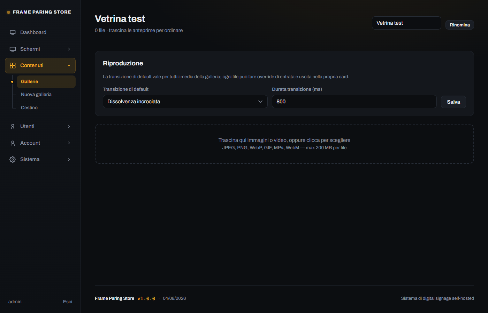
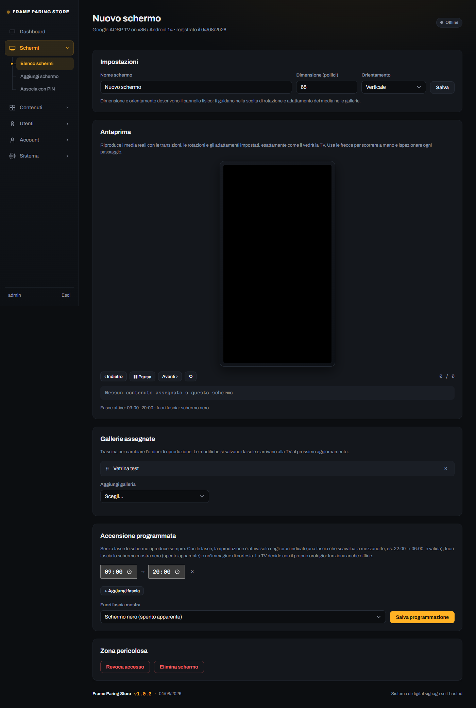
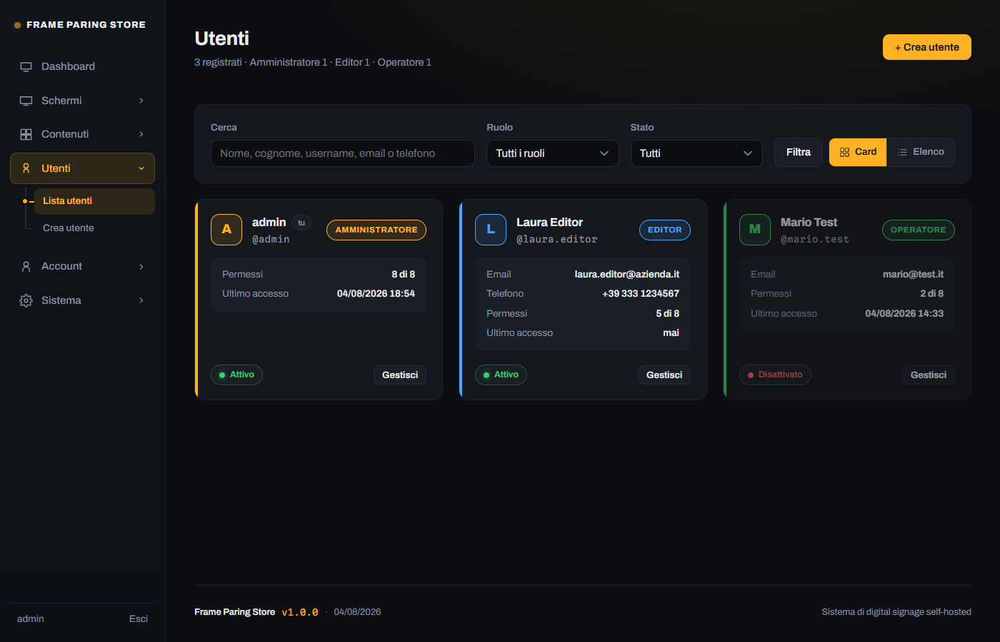
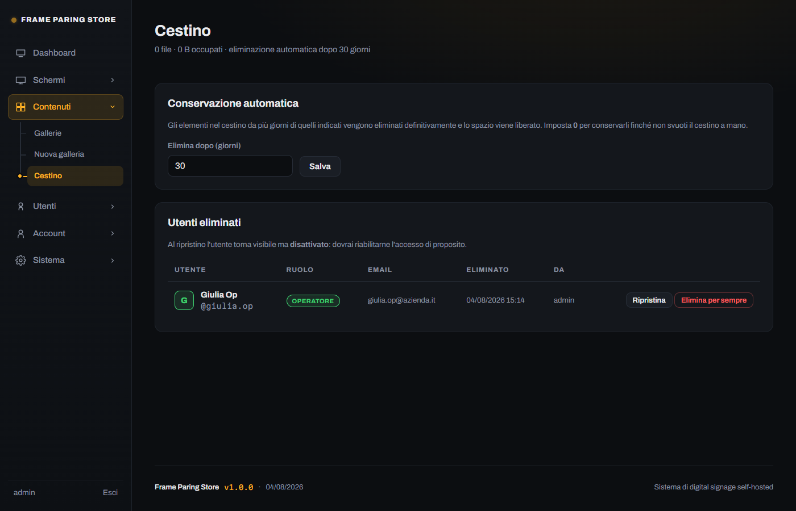
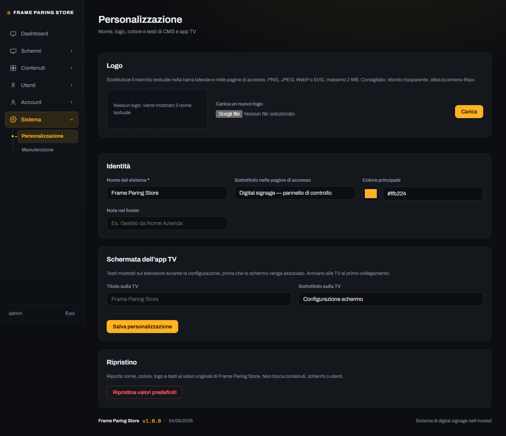

# Utilizzo del CMS

Guida alle funzioni del pannello di amministrazione.

## Dashboard

Panoramica del sistema: schermi online, numero di gallerie e file, spazio
occupato. Ogni schermo è rappresentato da una card che mostra il pannello
disegnato secondo il suo orientamento reale, il metodo di associazione, le
gallerie assegnate e lo stato.

Uno schermo risulta **online** se ha contattato il server negli ultimi due
cicli di aggiornamento (con l'impostazione predefinita, negli ultimi 2-3 minuti).

## Gallerie e media

Una galleria è un insieme ordinato di immagini e video. Un singolo schermo può
riprodurre più gallerie in sequenza.

### Caricare i file

Trascina i file nella zona di caricamento oppure fai clic per selezionarli. Si
caricano uno alla volta con avanzamento visibile; se qualcuno fallisce, il
messaggio resta a schermo per farti vedere quale e perché.

### Ordine di riproduzione

Trascina le anteprime per riordinarle: l'ordine si salva da solo e arriva alle
TV al successivo aggiornamento.

### Impostazioni di ogni file

| Impostazione | Effetto |
|---|---|
| **Rotazione** | 0°, 90°, 180°, 270° — applicata dall'app in riproduzione, il file non viene modificato |
| **Adattamento** | *Contain*: tutto visibile con eventuali bande. *Crop*: riempie lo schermo tagliando le eccedenze |
| **Durata a schermo** | Solo immagini: quanti secondi restano visibili |
| **Audio** | Solo video: riproduzione muta (predefinito, adatto alle vetrine) o con audio |
| **Entrata / Uscita** | Transizione specifica, oppure *Default* per ereditare quella della galleria |

Le modifiche si salvano da sole: il pallino accanto al pulsante Elimina diventa
verde a conferma.

### Transizioni

Nella scheda **Riproduzione** della galleria imposti la transizione predefinita
e la sua durata in millisecondi. Ogni file può discostarsene per l'entrata,
l'uscita o entrambe.

| Transizione | Effetto |
|---|---|
| Taglio secco | Cambio istantaneo |
| Dissolvenza (dal nero) | Sfuma al nero e riappare |
| Dissolvenza incrociata | I due contenuti si sovrappongono sfumando |
| Scorri a sinistra / destra / alto / basso | Il nuovo contenuto entra dal lato indicato |
| Zoom in / Zoom out | Ingrandimento o rimpicciolimento |
| Ken Burns | Lento zoom e deriva durante tutta l'esposizione dell'immagine |
| Casuale | Ne sceglie una diversa a ogni cambio |

### Anteprima

Il riquadro **Anteprima** riproduce i media reali con le transizioni, le
rotazioni e gli adattamenti impostati, dentro una cornice che rispetta
l'orientamento dello schermo. I comandi permettono di mettere in pausa e
scorrere manualmente per esaminare ogni passaggio; sotto è indicata la
configurazione attiva del contenuto mostrato.

L'anteprima è disponibile sia nella pagina di una galleria (solo quei
contenuti) sia nella pagina di uno schermo (playlist completa).

## Schermi

### Associare un nuovo schermo

Tre modi, tutti equivalenti nel risultato:

1. **PIN** — la TV mostra un codice a 6 cifre, tu lo digiti in *Schermi →
   Associa con PIN*.
2. **QR code** — inquadri col telefono il codice mostrato sulla TV: si apre il
   CMS con il PIN già inserito, confermi da lì.
3. **URL di configurazione** — crei lo schermo in *Schermi → Aggiungi schermo*
   e incolli nell'app la URL monouso che ottieni. Utile per preparare i
   dispositivi prima di installarli.

Il PIN vale 5 minuti; se scade, l'app ne genera uno nuovo da sola.

### Impostazioni dello schermo

- **Nome** — per riconoscerlo nell'elenco
- **Dimensione e orientamento** del pannello fisico: guidano le scelte di
  rotazione e adattamento dei media
- **Gallerie assegnate** — trascinabili per definire l'ordine di riproduzione

### Accensione programmata

Puoi definire una o più fasce orarie in cui lo schermo riproduce. Fuori fascia
mostra a scelta:

- **schermo nero**, che sembra spento (consumo minimo, nessuna immagine)
- **immagine di cortesia**, caricabile direttamente da questa scheda

Una fascia che scavalca la mezzanotte (per esempio 22:00 → 06:00) è valida.
Senza fasce lo schermo riproduce sempre.

> La programmazione è valutata dall'orologio del dispositivo, quindi funziona
> anche se la TV perde la connessione.

### Revoca ed eliminazione

**Revoca accesso** blocca l'autorizzazione della TV mantenendone la storia:
il dispositivo smette di ricevere contenuti e va riassociato.
**Elimina schermo** lo rimuove del tutto.

## Utenti e permessi

Tre ruoli predefiniti:

| Ruolo | Permessi predefiniti |
|---|---|
| **Amministratore** | Tutti, non modificabili |
| **Editor** | Media, gallerie, schermi, programmazione |
| **Operatore** | Solo caricamento e modifica dei media |

I permessi del singolo utente si possono personalizzare uno per uno: caricare
media, modificarne i metadati, creare gallerie, associare schermi, gestirli,
gestire le fasce orarie, gestire gli utenti, modificare le impostazioni di
sistema. Se riporti i permessi identici a quelli del ruolo, tornano a essere
ereditati automaticamente.

La lista si può filtrare per nome, cognome, username, email, telefono, ruolo e
stato, e si visualizza a **card** o a **elenco**.

Un utente **disattivato** non può accedere ma resta nell'elenco con la sua
storia. Il sistema impedisce di rimanere senza amministratori attivi e di
disattivare sé stessi.

## Cestino

Media, gallerie e utenti eliminati non spariscono subito: finiscono nel cestino
e restano ripristinabili. I file restano sul server finché non vengono
eliminati definitivamente.

- **Ripristina** riporta l'elemento al suo posto (una galleria ripristinata
  recupera anche i suoi file; un utente ripristinato torna visibile ma
  disattivato, per scelta consapevole)
- **Elimina per sempre** cancella riga e file, liberando spazio
- **Svuota cestino** fa la stessa cosa su tutto

La **conservazione automatica** elimina definitivamente ciò che è nel cestino
da più giorni di quelli impostati (predefinito 30; `0` disattiva la pulizia
automatica). La verifica avviene durante la normale navigazione nel CMS, quindi
non richiede attività pianificate sull'hosting.

## Personalizzazione

In *Sistema → Personalizzazione* puoi cambiare nome, logo, colore principale e
testi mostrati sia nel CMS sia sulla schermata di configurazione delle TV.
Le modifiche arrivano ai dispositivi al collegamento successivo, senza
ricompilare l'app.

## Manutenzione

In *Sistema → Manutenzione* trovi le informazioni tecniche dell'installazione
(versioni, limiti di upload, permessi delle cartelle) e due operazioni
irreversibili, entrambe protette da password e parola di conferma:

- **Reset completo**: azzera tutto e riporta il sistema alla configurazione
  iniziale
- **Disinstallazione**: azzera e disattiva l'accesso, con le istruzioni per
  rimuovere i file dall'hosting
